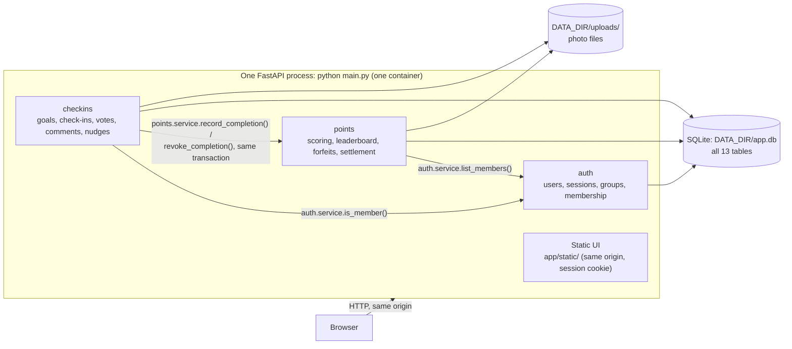
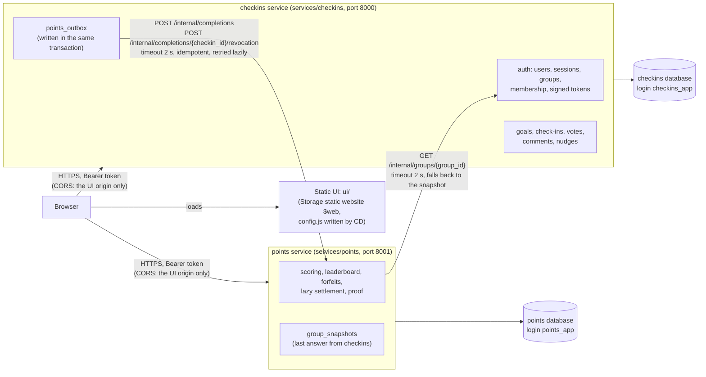
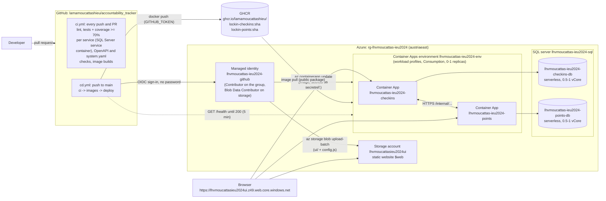
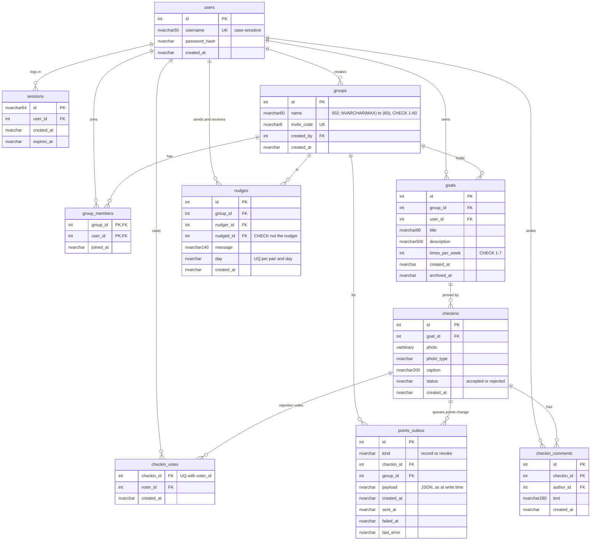
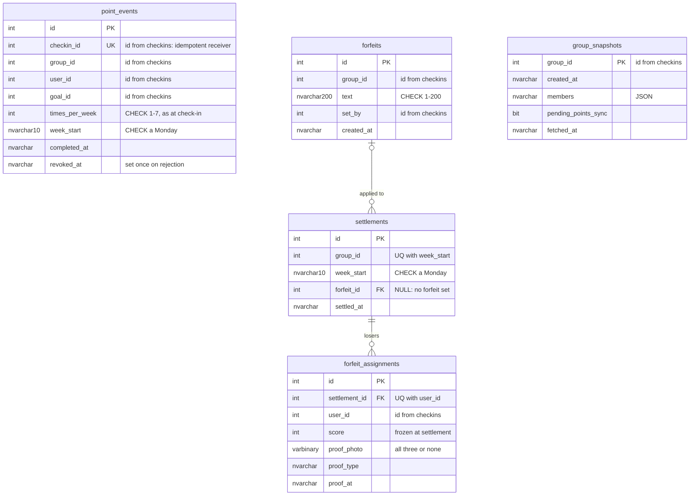

# Architecture diagrams

Drawn from the code at the graded commit: the A1 monolith from its last commit (`89ba165`,
2026-10-04), the split system from `services/`, the deployment from `.github/workflows/cd.yml`
and the README's Azure setup, and the database diagrams from each service's `migrations/`
(001 and 002). GitHub draws the Mermaid blocks; each one can be exported to PNG from
https://mermaid.live for the report.

## 1. Before: the Assignment 1 monolith

One process, one SQLite file. The domains are separate packages; they only meet through each
other's `service` module (ADR-2), so the seam already existed as Python calls.

## 2. After: two services, each with its own database

The seam is now HTTP. Auth moved into Checkins (it checks membership on almost every request).
The browser calls both services; the services call each other only on `/internal/...`
endpoints, with the shared `X-Internal-Key` and a 2 s timeout.

When **points** is down, a check-in or rejection is still saved, marked "points pending", and its
outbox row waits for a later check-in, vote or feed load. When **checkins** is down, points serves
reads from its last snapshot, marked possibly out of date, and answers changes with a 503.

## 3. Deployment

## 4. Database: checkins (migrations 001 and 002)

Every relationship is a foreign key inside this database. Not drawn: `schema_migrations`
(written by the migration runner) and `service_health` (one row `/health` writes).

## 5. Database: points (migration 001)

`group_id`, `user_id`, `goal_id`, `checkin_id` and `set_by` are ids from the checkins service:
plain columns, no foreign keys (ADR-7). The only foreign keys are inside this database.
Not drawn: `schema_migrations` and `service_health`.

